<h1 align="center">Chaqmoq</h1>

<p align="center">
  <strong>A fast, secure-by-default JavaScript &amp; TypeScript runtime, built on V8 and Rust.</strong>
</p>

<p align="center">
  <em>chaqmoq</em> (Uzbek) — <em>lightning</em>
</p>

<p align="center">
  <a href="#quick-start">Quick start</a> ·
  <a href="#what-it-can-do">Features</a> ·
  <a href="#the-permission-model">Permissions</a> ·
  <a href="#architecture">Architecture</a> ·
  <a href="#api-reference">API</a> ·
  <a href="#building-from-source">Build</a>
</p>

---

Chaqmoq runs `.js` and `.ts` files directly — no build step, no `node_modules`,
no configuration. TypeScript is transpiled on the way into V8, ES modules are
resolved from disk or over HTTPS, and every program starts with **zero** access
to your machine until you grant it on the command line.

<p align="center">
  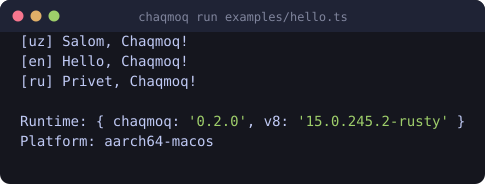
</p>

---

## Quick start

```bash
git clone https://github.com/ismoilovdevml/chaqmoq
cd chaqmoq
cargo build --release
./target/release/chaqmoq run examples/hello.ts
```

Write a file and run it:

```ts
// server.ts
interface Task {
  id: number;
  title: string;
}

const tasks: Task[] = [{ id: 1, title: "ship the runtime" }];

Chaqmoq.serve({ port: 8000 }, (request) => {
  const { pathname } = new URL(request.url);
  if (pathname === "/tasks") return Response.json(tasks);
  return new Response("Salom from Chaqmoq!");
});
```

```bash
chaqmoq run --allow-net=0.0.0.0:8000 server.ts
```

That is the whole workflow. The `interface` is stripped by the transpiler, the
`Response` and `URL` classes are web standard, and `--allow-net` is what makes
the socket bind legal.

---

## What it can do

<table>
<tr><td width="50%" valign="top">

**Language & modules**
- TypeScript, TSX and JSX, transpiled with swc
- ES modules from `file:`, `https:` and `data:` URLs
- JSON modules via `with { type: "json" }`
- Remote dependencies cached on disk
- Source-mapped stack traces back to your `.ts`
- Top-level `await`

</td><td width="50%" valign="top">

**Runtime APIs**
- `console` with a real value inspector, `table`, `group`, `time`
- `fetch`, `Request`, `Response`, `Headers`
- `Chaqmoq.serve` — an HTTP server built on hyper
- Filesystem: async and `*Sync`, permission checked
- `URL`, `URLSearchParams`, `TextEncoder`/`Decoder`, `crypto`
- `Event`, `EventTarget`, `AbortController`, timers

</td></tr>
<tr><td width="50%" valign="top">

**Tooling**
- `chaqmoq run`, `eval`, `repl`, `test`, `info`
- Built-in test runner with filtering
- `--watch` to re-run on file changes
- A REPL that keeps `let`/`const` across lines and awaits promises

</td><td width="50%" valign="top">

**Security**
- No filesystem, network, or environment access by default
- Scoped grants: `--allow-read=./data`, `--allow-net=api.github.com`
- Every syscall passes a permission check in Rust
- Typed error classes: `Chaqmoq.errors.NotFound`, `NotCapable`, …

</td></tr>
</table>

---

## The permission model

A program gets nothing until you say otherwise. The same script, run twice:

<p align="center">
  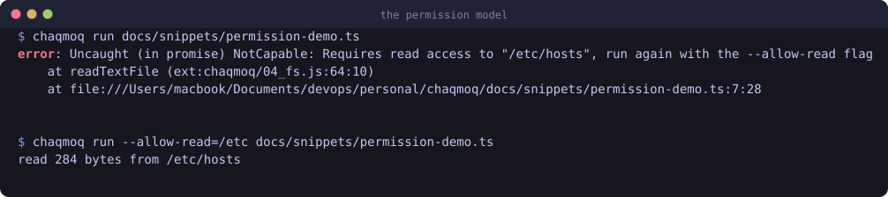
</p>

Every flag works in two forms — blanket, or scoped to specific subjects:

| Flag | Blanket | Scoped |
|---|---|---|
| `--allow-read` | all paths | `--allow-read=./data,./config` |
| `--allow-write` | all paths | `--allow-write=/tmp` |
| `--allow-net` | all hosts | `--allow-net=api.github.com,localhost:8000` |
| `--allow-env` | all variables | `--allow-env=HOME,PATH` |
| `--allow-sys` | all system info | `--allow-sys=hostname` |
| `-A`, `--allow-all` | everything | — |

Scoped paths are compared after `.` and `..` are resolved, so
`--allow-read=./data` cannot be escaped with `./data/../../etc/passwd`. A host
entry such as `example.com` matches any port; `example.com:443` is exact.

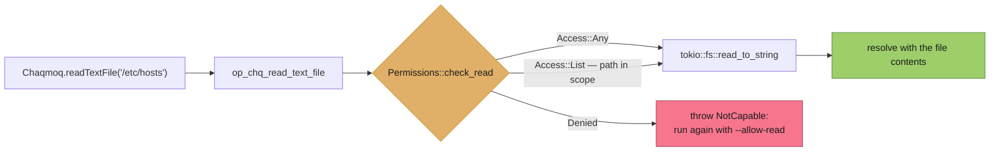

Local module *imports* are deliberately ungated: running `chaqmoq run app.ts` is
itself the grant for the code you asked to execute. `--allow-read` governs data
access — `Chaqmoq.readTextFile` and friends — which is where a program could
actually exfiltrate something. Remote imports do touch the network, so they stay
behind `--allow-net`.

---

## Architecture

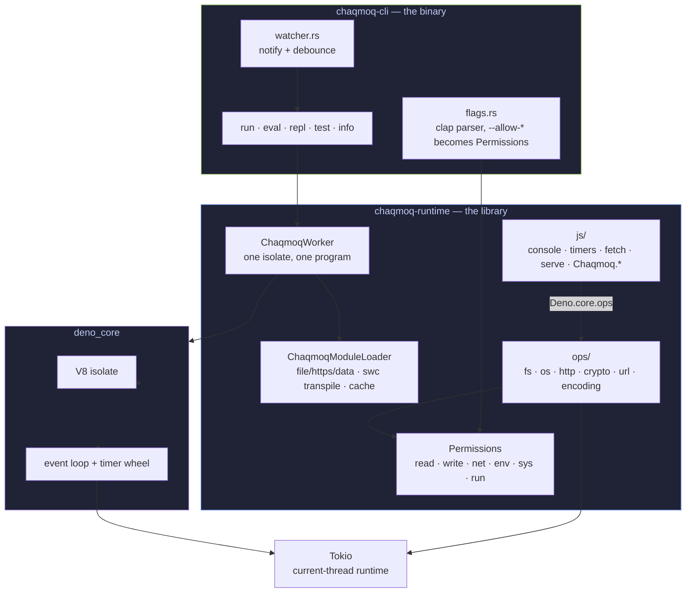

Three layers, and the boundary between them is the interesting part:

1. **JavaScript** (`crates/chaqmoq-runtime/js/`) implements the web-standard
   surface — `console`, `fetch`, `URL`, `Response`, timers. It is compiled into
   the binary as ES modules and evaluated once, before your code loads.
2. **Ops** (`crates/chaqmoq-runtime/src/ops/`) are the Rust functions the JS
   layer calls. Each one begins with a permission check; none of them can be
   reached without passing through it.
3. **deno_core** owns the V8 isolate, the module map and the event loop.
   Everything runs on a single thread, with blocking work handed to Tokio.

### How a program runs

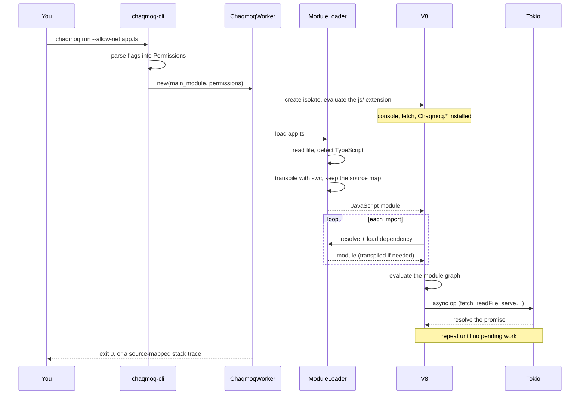

### Module resolution

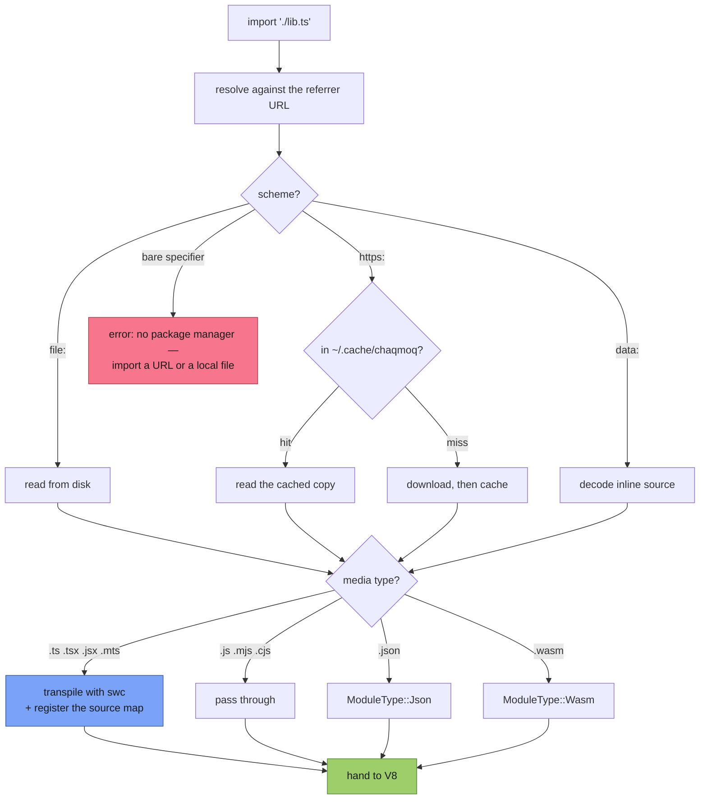

Chaqmoq transpiles TypeScript but does **not** type-check it — the same
trade-off as `deno run --no-check` or `tsx`. Types are a development-time
concern; keep `tsc --noEmit` in your editor and CI.

---

## In practice

### The console inspector

Values are rendered by a purpose-built inspector, not `JSON.stringify`: Maps,
Sets, typed arrays, class instances, getters and circular references all survive
the trip to your terminal.

<p align="center">
  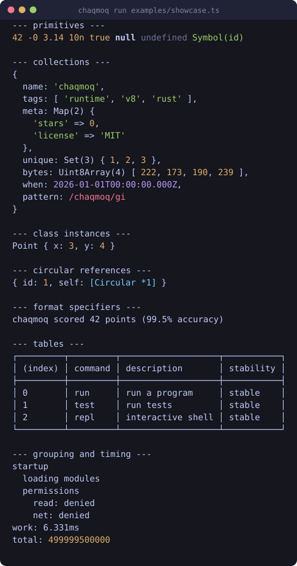
</p>

### Errors point at your source

A stack trace from a `.ts` file names the TypeScript line and column, not the
generated JavaScript.

<p align="center">
  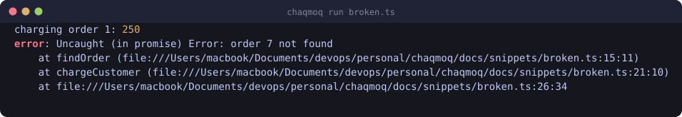
</p>

### HTTP, both directions

`Chaqmoq.serve` and `fetch` share one set of `Request`/`Response`/`Headers`
classes, so a handler and a client look the same.

<p align="center">
  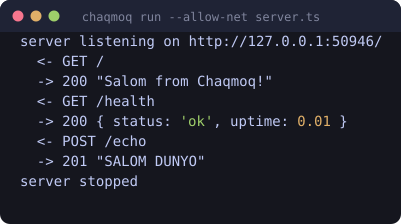
</p>

### A REPL that behaves

Bindings persist between lines, promises are awaited before printing, and
multi-line blocks continue until the brackets balance.

<p align="center">
  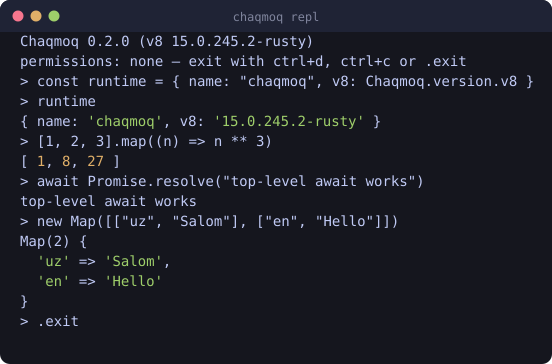
</p>

### The test runner

Register cases with `Chaqmoq.test`, then point `chaqmoq test` at a file or a
directory. It walks for `*_test.ts` / `*.test.ts`, skips `node_modules` and
friends, and exits non-zero on failure.

<p align="center">
  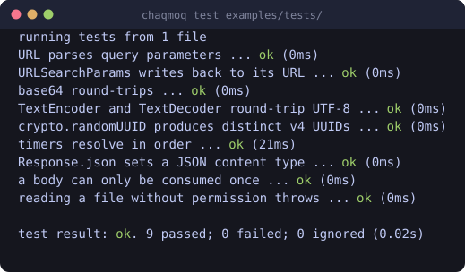
</p>

```ts
Chaqmoq.test("URL parses query parameters", () => {
  const url = new URL("https://chaqmoq.dev/search?q=runtime");
  if (url.searchParams.get("q") !== "runtime") throw new Error("mismatch");
});

Chaqmoq.test({ name: "not ready yet", ignore: true }, () => {});
```

```bash
chaqmoq test                        # everything under the working directory
chaqmoq test tests/ --filter url    # only tests whose name contains "url"
chaqmoq test --allow-read tests/    # tests get the permissions you grant
```

---

## CLI reference

<p align="center">
  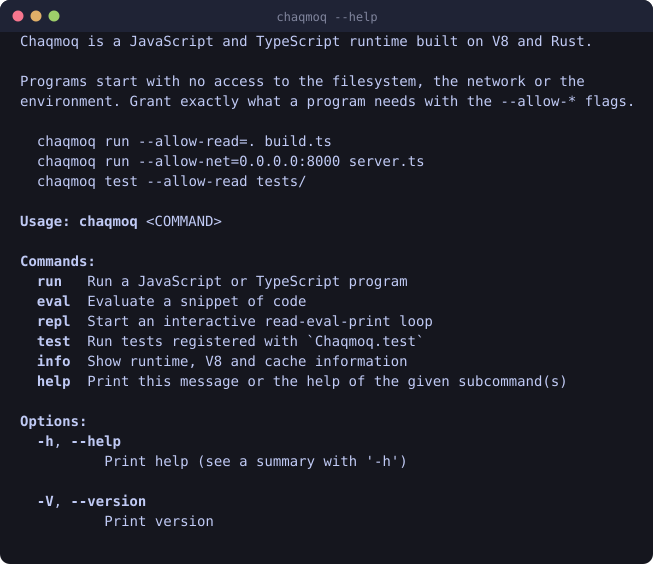
</p>

| Command | What it does |
|---|---|
| `chaqmoq run [flags] <file> [args…]` | Run a program. Arguments after the path arrive as `Chaqmoq.args`. |
| `chaqmoq run --watch <file>` | Re-run whenever a source file in the directory changes. |
| `chaqmoq eval [--ts] <code>` | Evaluate a snippet. |
| `chaqmoq repl` | Interactive shell. |
| `chaqmoq test [--filter S] [paths…]` | Discover and run tests. |
| `chaqmoq info` | Version, V8 build, target and cache location. |

Shared flags: the `--allow-*` family above, plus `--reload` to bypass the
remote-module cache.

<p align="center">
  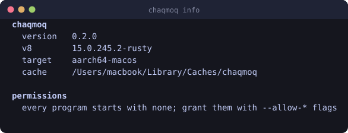
</p>

---

## API reference

Full type definitions live in [`types/chaqmoq.d.ts`](types/chaqmoq.d.ts). Point
your editor at them for completion:

```ts
/// <reference types="./types/chaqmoq.d.ts" />
```

### Web globals

Available without an import, as in a browser:

`console` · `fetch` · `Request` · `Response` · `Headers` · `URL` ·
`URLSearchParams` · `TextEncoder` · `TextDecoder` · `crypto` · `performance` ·
`atob` · `btoa` · `structuredClone` · `setTimeout` · `setInterval` ·
`setImmediate` · `queueMicrotask` · `Event` · `EventTarget` · `CustomEvent` ·
`AbortController` · `AbortSignal` · `DOMException`

### The `Chaqmoq` namespace

```ts
// Program
Chaqmoq.args;                 // string[] — arguments after the module path
Chaqmoq.mainModule;           // URL of the entry module
Chaqmoq.pid;                  // number
Chaqmoq.version;              // { chaqmoq, v8 }
Chaqmoq.build;                // { target, arch, os, family, v8, chaqmoq, rustc }
Chaqmoq.exit(code?);          // never returns
Chaqmoq.cwd();                // --allow-read
Chaqmoq.chdir(path);          // --allow-read
Chaqmoq.hostname();           // --allow-sys
Chaqmoq.memoryUsage();        // { rss, heapTotal, heapUsed, external }
Chaqmoq.stdout / stderr;      // { write, writeSync }

// Environment — every accessor needs --allow-env
Chaqmoq.env.get(key) / set(key, value) / delete(key) / has(key) / toObject();

// Filesystem — reads need --allow-read, writes need --allow-write.
// Every function also has a *Sync form.
await Chaqmoq.readTextFile(path);
await Chaqmoq.writeTextFile(path, text, { append });
await Chaqmoq.readFile(path);                      // Uint8Array
await Chaqmoq.writeFile(path, bytes, { append });
await Chaqmoq.readDir(path);                       // DirEntry[], sorted
await Chaqmoq.mkdir(path, { recursive });
await Chaqmoq.remove(path, { recursive });
await Chaqmoq.stat(path) / lstat(path);            // FileInfo
await Chaqmoq.copyFile(from, to) / rename(from, to);
await Chaqmoq.exists(path) / realPath(path);
await Chaqmoq.makeTempDir({ prefix });

// HTTP server — needs --allow-net
const server = Chaqmoq.serve({ port, hostname, onListen, onError }, handler);
server.addr;        // { hostname, port, transport }
server.finished;    // Promise<void>
server.shutdown();

// Testing & utilities
Chaqmoq.test(name, fn);
Chaqmoq.inspect(value, { depth });
Chaqmoq.errors.NotFound / NotCapable / AlreadyExists / ConnectionRefused / …
```

### Handling failures by kind

```ts
try {
  await Chaqmoq.readTextFile("./config.json");
} catch (error) {
  if (error instanceof Chaqmoq.errors.NotFound) return defaults;
  if (error instanceof Chaqmoq.errors.NotCapable) {
    console.error("re-run with --allow-read");
    Chaqmoq.exit(1);
  }
  throw error;
}
```

---

## Examples

| File | Run it with |
|---|---|
| [`examples/hello.ts`](examples/hello.ts) | `chaqmoq run examples/hello.ts` |
| [`examples/showcase.ts`](examples/showcase.ts) | `chaqmoq run examples/showcase.ts` |
| [`examples/filesystem.ts`](examples/filesystem.ts) | `chaqmoq run --allow-read --allow-write examples/filesystem.ts` |
| [`examples/http-server.ts`](examples/http-server.ts) | `chaqmoq run --allow-net=0.0.0.0:8000 examples/http-server.ts` |
| [`examples/fetch.ts`](examples/fetch.ts) | `chaqmoq run --allow-net=api.github.com examples/fetch.ts denoland/deno` |
| [`examples/tests/`](examples/tests/) | `chaqmoq test examples/tests/` |

---

## Building from source

Requires a Rust toolchain (1.85+). V8 is downloaded as a prebuilt static library
by the `v8` crate, so no C++ toolchain or GN/Ninja setup is needed.

```bash
cargo build --release
cargo test --workspace         # 46 unit and end-to-end tests
cargo clippy --workspace --all-targets -- -D warnings
cargo fmt --all -- --check
```

The binary lands at `target/release/chaqmoq`.

### Repository layout

```
crates/
  chaqmoq-runtime/         the library: isolate, ops, module graph, permissions
    src/
      lib.rs               ChaqmoqWorker + the extension definition
      permissions.rs       the security model
      module_loader.rs     file/https/data resolution, swc transpile, cache
      errors.rs            stack-trace formatting
      ops/                 fs · os · http · crypto · url · encoding
    js/                    the JavaScript layer, embedded at build time
  chaqmoq-cli/             the binary: flags, repl, test runner, watcher
    tests/cli.rs           end-to-end tests against the real binary
types/chaqmoq.d.ts         TypeScript definitions for the Chaqmoq namespace
examples/                  runnable programs
docs/tools/                the screenshot pipeline used by this README
legacy/                    earlier prototypes, kept for the record
```

### Regenerating the screenshots

Every terminal image in this README is generated from real command output —
captured through a pseudo-terminal so colours match what you see, then rendered
to SVG. They cannot drift away from the runtime's actual behaviour.

```bash
./docs/tools/capture.sh
```

---

## Where this came from

Chaqmoq started as a set of experiments in how a runtime actually talks to the
operating system: raw `write` syscalls in Rust inline assembly, a hand-written
epoll/kqueue event loop with a thread pool, then a C++ program embedding V8 and
libuv directly. Those prototypes are preserved under [`legacy/`](legacy/) — they
do not build as part of the workspace, but they are the reason this project
exists.

| Prototype | What it explored |
|---|---|
| [`legacy/syscalls/`](legacy/syscalls/) | `write(2)` on Linux, macOS and Windows, from inline assembly up to `libc` |
| [`legacy/eventloop/`](legacy/eventloop/) | A Node-shaped event loop: thread pool, timer wheel, epoll registration |
| [`legacy/denocore-poc/`](legacy/denocore-poc/) | First contact with `deno_core` |
| [`legacy/cpp-v8/`](legacy/cpp-v8/) | Embedding V8 and libuv from C++ by hand |

The current runtime keeps the goal and replaces the foundation: `deno_core` for
the isolate and event loop, Tokio for I/O, and a permission check in front of
everything that leaves the sandbox.

---

## Limitations

Worth knowing before you reach for it:

- **No type checking.** TypeScript is transpiled, not verified.
- **No npm.** There is no package manager and no `node_modules` resolution;
  dependencies are URLs.
- **Buffered HTTP bodies.** Requests and responses are fully materialised rather
  than streamed, which is fine for APIs and wrong for large uploads.
- **No `node:` compatibility layer.** Code written against Node's standard
  library will not run unchanged.
- **No subprocesses.** `--allow-run` is parsed and reserved, but no API uses it.
- **Single isolate.** No workers, no threads exposed to JavaScript.

---

## Roadmap

- Streaming request and response bodies
- WebSocket client and server
- `Chaqmoq.command` for subprocesses, behind `--allow-run`
- A `node:`-compatible shim for the most common modules
- Startup snapshots to cut isolate creation time
- `chaqmoq compile` — a single-file executable

---

## Contributing

Issues and pull requests are welcome. Before opening a PR:

```bash
cargo fmt --all
cargo clippy --workspace --all-targets -- -D warnings
cargo test --workspace
```

A new runtime API needs three things: the op with its permission check, the
JavaScript wrapper, and a test in `crates/chaqmoq-cli/tests/cli.rs` or
`examples/tests/`.

---

## License

[MIT](LICENSE) © Otabek Ismoilov

Built on [deno_core](https://github.com/denoland/deno_core),
[V8](https://v8.dev), [swc](https://swc.rs), [Tokio](https://tokio.rs) and
[hyper](https://hyper.rs).
